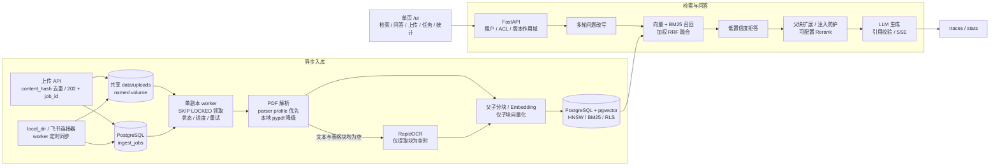
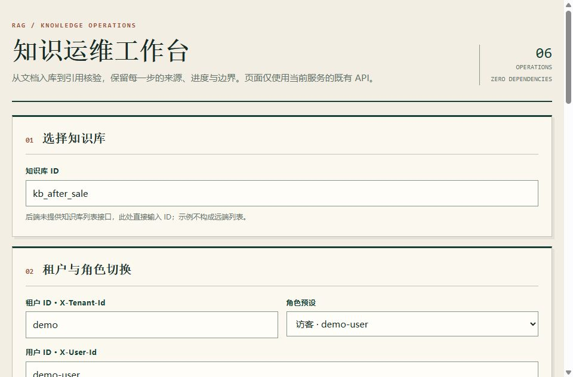

# rag-knowledge-base

面向多行业客服/陪伴场景的知识库问答（RAG）项目，覆盖异步入库、混合检索、拒答与引用、流式问答、运营统计和单页工作台。

## 架构



- **入库边界**：上传 API 只负责接收、去重、落盘和入队；worker 每轮最多处理一条任务，通过 `FOR UPDATE SKIP LOCKED` 原子领取，执行任务状态、进度与最多三次尝试。API 与 worker 必须共享上传目录。
- **PDF 边界**：独立 parser 使用 pdfplumber 提取文本和表格，只有提取块为空才调用 RapidOCR；未配置 parser 或 parser 请求失败时，主服务退回本地 pypdf，本地路径不会自行 OCR。
- **检索与隔离**：子块用于召回，父块用于补充上下文；向量与 BM25 经加权 RRF 融合。强制租户作用域、文档 ACL 和 chunks RLS 共同约束可见范围。
- **可观测与操作**：`/v1/traces/{trace_id}` 记录阶段耗时与命中情况，`/v1/stats` 汇总任务和问答指标；`/ui/` 提供单页知识运维工作台。

设计取舍见 [ADR 0007：数据库异步入库](docs/adr/0007-async-ingest.md) 与 [ADR 0008：PDF 本地降级与 OCR 回退](docs/adr/0008-ocr-fallback.md)。

## 五步启动

前置条件：Windows PowerShell、Python 3.13（通过 `py` 启动）和 Docker Compose。以下五条命令均在仓库根目录顺序执行；第 4 步包含可选的 `parser` profile，以支持扫描件 OCR。

1. 安装本机开发、测试及 PDF 测试依赖：

   ```powershell
   py -3.13 -m pip install -e ".[test]"
   ```

2. 启动 PostgreSQL 16 + pgvector（宿主端口 `5433`）：

   ```powershell
   docker compose -f deploy/docker-compose.yml up -d db
   ```

3. 构建临时 API 镜像并执行全部 Alembic 迁移（包括 `kb_app` 与 RLS）：

   ```powershell
   docker compose -f deploy/docker-compose.yml run --rm --build api alembic upgrade head
   ```

4. 启动 API、单副本 worker 和 parser；API 与 worker 通过 `uploads` named volume 共享文件：

   ```powershell
   docker compose --profile parser -f deploy/docker-compose.yml up -d --build api worker parser
   ```

5. 查看四个服务的运行与健康状态：

   ```powershell
   docker compose --profile parser -f deploy/docker-compose.yml ps
   ```

启动后访问 `http://127.0.0.1:8000/ui/`；存活与就绪端点分别为 `/live`、`/ready`，OpenAPI 页面为 `/docs`。完整故障恢复演练见 [运行手册](docs/runbook.md)。

### mock 与真实模型

- 当前 Compose 显式使用 `EMBED_MODE=mock`，无 Key 即可验收上传、检索与任务链路。mock 是 1024 维确定性哈希向量，没有语义，界面分数不能解释为真实检索质量；对话仍需为 API 进程配置 `LLM_API_KEY`（容器内须显式注入）。
- `scripts/demo_pipeline.py` 保留 `--mock` 与 `--real` 两种端到端演示。真实模式按 `.env.example` 配置进程环境变量，默认 Embedding 为 SiliconFlow `BAAI/bge-m3`，对话为 DeepSeek `deepseek-chat`，可用对应 base URL / model 环境变量覆盖。
- `EMBED_BASE_URL`、`EMBED_MODEL`、`LLM_BASE_URL`、`LLM_MODEL` 只改变模型提供方或模型名；真实模型结果必须单独记录，不能和 mock 基线混比。

## UI 证据



截图来自已提交的真实浏览器手工验收，覆盖选库、检索、流式问答、引用展开、角色切换和上传完成状态；运行时的检索分数为 mock 模式结果。完整操作、结果与证据边界见 [UI 验收清单](docs/ui-checklist.md)。

## 真实模型评测

以下为 **2026-11-19 19:27** 一次本地真实模型运行：`mock=false`、Embedding 使用真实 `BAAI/bge-m3`、`hybrid`、`top_k=5`、开启生成。语料共 26 个 chunks；用例共 50 条，其中 38 条可回答、12 条不可回答；生成失败 0 条。

| 指标 | 实测值 | 分母与语义 |
|---|---:|---|
| Recall@5 | 1.0000 | 38 条可回答题；逐题计算前 5 条命中的标注 chunk 比例后取均值，多标注可部分得分 |
| MRR@5 | 0.9737 | 38 条可回答题；前 5 条中首个正确结果的倒数排名均值 |
| Hit Rate@5 | 1.0000 | 38 条可回答题中，Recall@5 大于 0 的比例 |
| 拒答准确率 | 1.0000 | 12 条不可回答题中正确拒答的比例（12/12） |
| 答案覆盖率 | 0.9211 | 38 条可回答题中未拒答的比例（35/38）；本次生成失败 0 条 |
| 引用准确率 | 1.0000 | 35 条可回答、生成成功且未拒答的回答，逐条计算引用 chunk_id 存在于实际上下文的比例后取均值；无引用回答不进分母，本次为 0 条 |

证据边界：原始输出位于本次工作区的 `eval/baseline_real_gen.json`，该文件是**未跟踪的本地证据**，不会随干净检出分发，因此这里不把它链接成仓库基线。以上数值只代表这次小型语料、用例与参数组合，不是通用榜单成绩。复现需使用当前生成评测实现 `scripts/run_eval.py`，自行配置真实模型 Key，并在相同检索与生成条件下重新导出结果；指标实现口径见 `src/metrics.py` 与 `scripts/run_eval.py`。

完整回归测试使用 `py -3.13 -m pytest -q`；数据库不可用时会跳过需要真实 PostgreSQL 的集成用例，应以命令实际输出的 passed / skipped / warning 为准，不沿用历史计数。
