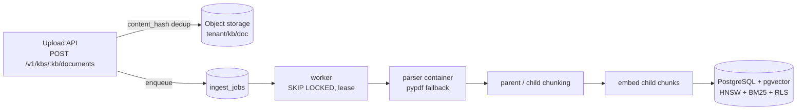
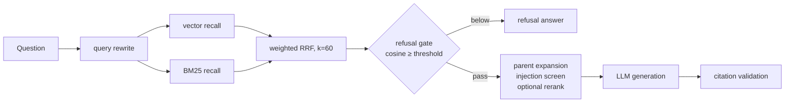

# rag-knowledge-base

[](https://github.com/dengyouming163/rag-knowledge-base/actions/workflows/ci.yml)

[](LICENSE)

English | [简体中文](README.zh-CN.md)

## What this is

A multi-tenant retrieval-augmented generation (RAG) service for enterprise knowledge. It covers the full path from document intake to governed answers:

**asynchronous ingestion → hybrid retrieval → citation-validated generation → operations console.**

It is built for customer-support knowledge bases, compliance and policy corpora, and internal documentation, where answers must be traceable to a specific source chunk and where cross-tenant data must never leak. Tenant scope, document-level ACL tags and PostgreSQL row-level security are enforced on every read of the chunk table; answers that lack sufficiently similar evidence are refused instead of guessed.

## Capabilities

- **Asynchronous ingestion** — the upload API writes the object, deduplicates by `content_hash`, enqueues a job and returns `202`; a single-replica worker claims one job per loop with `FOR UPDATE SKIP LOCKED`, reports stage progress, retries up to three attempts and records terminal failures.
- **OCR fallback** — a standalone parser container (pdfplumber) extracts headings, text and table blocks; RapidOCR is invoked only when the parsed block list is empty. If the parser is not configured or unreachable, PDF parsing degrades to local `pypdf` (the local path never performs OCR).
- **Parent/child chunking** — child chunks are embedded and matched; parent chunks are substituted into the prompt for context. Only child chunks carry vectors.
- **Hybrid retrieval** — pgvector HNSW (`m=16`, `ef_construction=100`, cosine) plus BM25, fused with weighted Reciprocal Rank Fusion (`k=60`).
- **Refusal gate** — generation is skipped when the maximum vector cosine similarity of the retrieved context is below `REFUSAL_MIN_SIMILARITY` (default `0.56`, defined in `src/refusal.py`). The rank-based fusion score is deliberately not used as a confidence signal.
- **Citation validation** — every `[chunk_id]` in the answer is checked against the chunks actually placed in the context (`src/citation.py`); invalid identifiers are reported rather than silently rewritten.
- **SSE chat** — `POST /v1/chat/stream` streams a `hits` event, answer deltas and `[DONE]`, with trace and token-usage metadata on the first event.
- **Isolation** — PostgreSQL RLS on `chunks` (migration `0007_rls_chunks.py`) with a non-superuser application role, plus document ACL tag intersection (`src/acl.py`).
- **Operations cockpit** — the no-build console at `/ui/` exposes health, queue state, job event timelines, traces, AI metrics, evaluation runs, identity comparison and audit entries.
- **Storage view** — `GET /v1/storage` lists documents, sizes, status and the active backend (`local` or `s3`).
- **Embedding drift report** — `GET /v1/ops/storage/embedding-drift` compares stored `embed_model_version` values per knowledge base against the configured `EMBED_MODEL`; a startup warning is logged when drift exists.
- **Configurable limits** — `MAX_UPLOAD_BYTES` (default 50 MB) is enforced before any database or disk write; `JOB_LEASE_SECONDS` (default 900 s) reclaims jobs stuck in `running`; `CORS_ALLOW_ORIGINS` is empty by default, so cross-origin access is off unless explicitly allow-listed.

## Architecture

Ingestion path:



Query path:



Request handling is layered: HTTP routers in `app/routers/` delegate to `app/services.py`, which assembles `src/*` components (retrieval, pipeline, ingestion, storage) over PostgreSQL/pgvector and the configured object store. The application entry point is `app/main.py`; ingestion runs through `src/ingest.py` and `src/worker.py`; retrieval and generation are `src/retrieve.py` and `src/pipeline.py`; job state lives in `src/ingest_jobs.py`; isolation is established by `migrations/versions/0007_rls_chunks.py`. Architectural rationale is recorded in the ADRs under [`docs/adr/`](docs/adr/README.md), and the layer-by-layer description is in [`docs/ARCHITECTURE.md`](docs/ARCHITECTURE.md).

## Quickstart

Requirements: Docker with Compose v2 and a shell. From the repository root:

```bash
cp .env.example .env
docker compose -f deploy/docker-compose.yml up -d --build
docker compose -f deploy/docker-compose.yml exec -T api alembic upgrade head
```

Then open `http://127.0.0.1:8000/ui/`.

The Compose stack publishes the API on port `8000`, PostgreSQL on host port `5433` (container `5432`), MinIO on `9000`/`9001` when the `minio` services are started, and the parser on `8100` when the `parser` profile is used. The default configuration uses `EMBED_MODE=mock`, which produces deterministic 1024-dimension hash vectors with no semantic meaning: it proves the pipeline works and cannot be used for quality claims. Chat requires `LLM_API_KEY` in the API process environment.

## Live Demo

**<http://132.232.166.40:18000/ui/>** — this is a public showcase instance, so the credentials below are published on purpose:

| Field | Value |
|---|---|
| Basic Auth user | `demo` |
| Basic Auth password | `TEJax7hnwrzg2kj7` |
| Tenant header | `X-Tenant-Id: demo` |

The dataset is synthetic and non-sensitive: 17 files (15 legal `.docx` templates, one Markdown after-sales policy and one PDF) ingested into the `kb_after_sale` knowledge base, 280 chunks in total. Per-IP rate limiting is 10 r/s (burst 20) and uploads are capped at 50 MB. The instance is disposable and may be reset or rotated at any time.

```bash
curl -u demo:TEJax7hnwrzg2kj7 -H 'X-Tenant-Id: demo' \
  http://132.232.166.40:18000/v1/storage
```

## API summary

The authoritative OpenAPI contract is `/docs` (and `/openapi.json`); the human-readable overview is [`docs/API.md`](docs/API.md).

| Method and path | Purpose |
|---|---|
| `POST /v1/kbs/{kb_id}/documents` | Upload one file, deduplicate by content hash, enqueue a job, return `202` with `job_id` and `doc_id` |
| `GET /v1/jobs/{job_id}` | Read one ingestion job (status, attempts, progress, error) for the current tenant |
| `POST /v1/kbs/{kb_id}/search` | Hybrid / vector / BM25 retrieval with `top_k`, `mode` and `audience` |
| `POST /v1/chat/stream` (SSE) | Rewrite, retrieve, gate, generate and validate citations; streams `hits`, deltas and `[DONE]` |
| `GET /v1/storage` | List stored documents with size, status and active storage backend |
| `GET /v1/ops/storage/embedding-drift` | Per-knowledge-base embedding version distribution and drift count |
| `GET /live` | Liveness probe; always `200` while the process is running |
| `GET /ready` | Readiness probe; checks PostgreSQL, cached for 5 seconds, `503` when the database is down |

The tenant is taken from the `X-Tenant-Id` header (default `demo`) and never from the request body; this header is a placeholder until token-based authentication lands.

## Evaluation

Measured with real `BAAI/bge-m3` embeddings and a real `deepseek-chat` generation model, `mode=hybrid`, `top_k=5`, over `eval/cases.jsonl` (50 cases: 38 answerable, 12 unanswerable) and `eval/demo_corpus.json` (26 chunks). Raw output: `eval/baseline_real_gen.json`.

| Metric | Value | Scope and definition |
|---|---:|---|
| Recall@5 | **1.0000** | 38 answerable cases; mean per-case fraction of labelled chunks found in the top 5 |
| MRR@5 | **0.9737** | 38 answerable cases; mean reciprocal rank of the first correct chunk |
| Citation accuracy | **1.0000** | Answers that were answerable, generated and not refused; fraction whose cited `chunk_id`s exist in the actual context |
| Refusal accuracy | **1.0000** | 12 unanswerable cases; fraction correctly refused (12/12) |
| Answer coverage | **0.9211** | 38 answerable cases not refused (35/38) |
| Generation errors | **0** | No case failed during rewriting or generation |

Mock baseline (`eval/baseline.json`, deterministic hash vectors, retrieval only): Recall@5 `0.9342`, MRR `0.8575`, hit rate `0.9474`. Mock vectors exercise the pipeline and the regression gate; they are not evidence of retrieval or answer quality. Reproduce and interpret these numbers with [`docs/EVALUATION.md`](docs/EVALUATION.md).

## Repository layout

```text
app/                  FastAPI entry point, routers, dependency wiring, static console
  routers/            documents, jobs, search, chat, stats, traces, identity, ops, health
  main.py             application factory, CORS, exception mapping, /ui mount
src/                  domain logic
  ingest.py           parse → chunk → embed → publish
  ingest_jobs.py      job state machine, lease recovery, retries
  worker.py           single-job claim loop
  retrieve.py         vector + BM25 + weighted RRF
  pipeline.py         rewrite → retrieve → gate → generate → citation check
  storage.py          local and S3 object storage
  acl.py, refusal.py, citation.py, guard/injection.py
migrations/           Alembic revisions, including 0007 RLS on chunks
deploy/               docker-compose files, nginx demo gateway, MinIO policies
scripts/              run_worker, run_ops, run_eval, ci_gate, loadtest, reembed_chunks, deploy_demo
tests/                pytest suite and front-end unit tests
eval/                 evaluation suite, corpus, baselines and calibration data
docs/                 architecture, deployment, operations, security, API, evaluation, roadmap
```

## Operations

Start with [`docs/OPERATIONS.md`](docs/OPERATIONS.md): probe semantics (`/live`, `/ready`, gateway `/health`), job diagnosis through `GET /v1/ops/jobs` and `GET /v1/ops/jobs/{job_id}/events`, manual retry (requires `OPS_ENABLE_ACTIONS=1` and `users.role='admin'`), stale-job recovery, embedding drift remediation with `scripts/reembed_chunks.py`, log and load-test commands, and the common failure modes with their symptoms. Degradation drills are documented in [`docs/runbook.md`](docs/runbook.md). Deployment and environment variables are covered in [`docs/DEPLOYMENT.md`](docs/DEPLOYMENT.md).

## Security

Report vulnerabilities privately as described in [`SECURITY.md`](SECURITY.md). The trust boundary, authentication model, RLS and ACL design, prompt-injection screening and demo-environment caveats are documented in [`docs/SECURITY.md`](docs/SECURITY.md).

## License

Apache License 2.0 — see [`LICENSE`](LICENSE).

Further reading: [`docs/ROADMAP.md`](docs/ROADMAP.md), [`CHANGELOG.md`](CHANGELOG.md), [`CONTRIBUTING.md`](CONTRIBUTING.md), [`CODE_OF_CONDUCT.md`](CODE_OF_CONDUCT.md).
