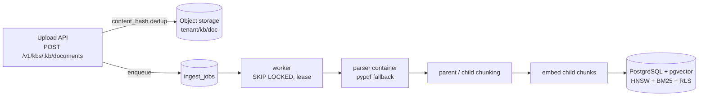
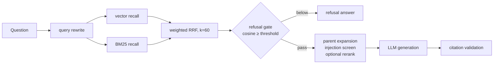

# rag-knowledge-base

[](https://github.com/dengyouming163/rag-knowledge-base/actions/workflows/ci.yml)

[](LICENSE)

[English](README.md) | 简体中文

## What this is

面向企业知识的多租户检索增强生成（RAG）服务，覆盖从文档入库到受控回答的完整链路：

**异步入库 → 混合检索 → 引用校验生成 → 运维控制台。**

适用于客服知识库、合规与政策语料、内部文档等场景：回答必须能追溯到具体来源块，跨租户数据不得泄漏。租户作用域、文档级 ACL 标签与 PostgreSQL 行级安全在每次读取知识块时生效；证据相似度不足时直接拒答，而不是猜测作答。

## Capabilities

- **异步入库**：上传接口只负责写入对象、按 `content_hash` 去重、入队并返回 `202`；单副本 worker 每轮用 `FOR UPDATE SKIP LOCKED` 领取一条任务，上报阶段进度，最多重试三次，并记录终态失败。
- **OCR 回退**：独立 parser 容器（pdfplumber）提取标题、文本与表格块；仅当解析块列表为空时才调用 RapidOCR。未配置或无法连通 parser 时，PDF 解析降级为本地 `pypdf`（本地路径不执行 OCR）。
- **父子分块**：子块用于向量化与召回，命中后以父块正文补充上下文；只有子块携带向量。
- **混合检索**：pgvector HNSW（`m=16`、`ef_construction=100`、余弦距离）与 BM25 双路召回，使用加权 RRF（`k=60`）融合。
- **拒答闸门**：检索上下文的向量余弦相似度最大值低于 `REFUSAL_MIN_SIMILARITY`（默认 `0.56`，定义在 `src/refusal.py`）时跳过生成。融合分数基于名次，刻意不作为置信度。
- **引用校验**：回答中的每个 `[chunk_id]` 都会与实际放入上下文的块比对（`src/citation.py`）；非法引用只做标记与统计，不静默改写模型输出。
- **SSE 问答**：`POST /v1/chat/stream` 依次下发 `hits` 事件、回答增量与 `[DONE]`，首个事件携带 trace 与 token 用量信息。
- **隔离**：`chunks` 表启用 PostgreSQL RLS（迁移 `0007_rls_chunks.py`），应用使用非超级用户角色；同时按文档 ACL 标签取交集（`src/acl.py`）。
- **运维控制台**：`/ui/` 提供免构建单页控制台，覆盖健康状态、队列、任务事件时间线、Trace、AI 指标、评测运行、身份对比与操作审计。
- **存储视图**：`GET /v1/storage` 返回文档列表、大小、状态与当前存储后端（`local` 或 `s3`）。
- **向量漂移报告**：`GET /v1/ops/storage/embedding-drift` 按知识库对比已存 `embed_model_version` 与配置的 `EMBED_MODEL`；存在漂移时启动日志会给出告警。
- **可配置限制**：`MAX_UPLOAD_BYTES`（默认 50 MB）在写入数据库或磁盘之前生效；`JOB_LEASE_SECONDS`（默认 900 秒）回收卡在 `running` 的任务；`CORS_ALLOW_ORIGINS` 默认为空，未显式配置白名单时不开放跨域。

## Architecture

入库链路：



查询链路：



请求处理分层：`app/routers/` 中的 HTTP 路由调用 `app/services.py`，由后者在 PostgreSQL/pgvector 与配置的对象存储之上装配 `src/*` 组件（检索、流水线、入库、存储）。应用入口是 `app/main.py`；入库由 `src/ingest.py` 与 `src/worker.py` 执行；检索与生成分别是 `src/retrieve.py` 与 `src/pipeline.py`；任务状态位于 `src/ingest_jobs.py`；隔离由 `migrations/versions/0007_rls_chunks.py` 建立。设计取舍记录在 [`docs/adr/`](docs/adr/README.md)，分层说明见 [`docs/ARCHITECTURE.md`](docs/ARCHITECTURE.md)。

## Quickstart

前置条件：安装 Docker 与 Compose v2 的 shell 环境。在仓库根目录执行：

```bash
cp .env.example .env
docker compose -f deploy/docker-compose.yml up -d --build
docker compose -f deploy/docker-compose.yml exec -T api alembic upgrade head
```

然后打开 `http://127.0.0.1:8000/ui/`。

Compose 栈将 API 发布到 `8000`，PostgreSQL 发布到宿主 `5433`（容器内 `5432`）；启动 `minio` 服务时 MinIO 使用 `9000`/`9001`，使用 `parser` profile 时 parser 使用 `8100`。默认配置为 `EMBED_MODE=mock`，生成确定性的 1024 维哈希向量，不具备语义：它只能证明链路可用，不能作为质量结论。问答需要在 API 进程环境中配置 `LLM_API_KEY`。

## Live Demo

`http://<demo-url>:18000/ui/` — HTTP Basic Auth；凭据由部署方保管。演示数据为合成数据，不含敏感信息。

## API summary

权威 OpenAPI 契约见 `/docs`（以及 `/openapi.json`）；可读概览见 [`docs/API.md`](docs/API.md)。

| 方法与路径 | 用途 |
|---|---|
| `POST /v1/kbs/{kb_id}/documents` | 上传单个文件，按内容哈希去重，入队并返回 `202` 及 `job_id`、`doc_id` |
| `GET /v1/jobs/{job_id}` | 查询当前租户的单条入库任务（状态、尝试次数、进度、错误） |
| `POST /v1/kbs/{kb_id}/search` | 混合 / 向量 / BM25 检索，支持 `top_k`、`mode`、`audience` |
| `POST /v1/chat/stream`（SSE） | 改写、检索、闸门、生成与引用校验；流式下发 `hits`、增量与 `[DONE]` |
| `GET /v1/storage` | 列出已存文档的大小、状态与当前存储后端 |
| `GET /v1/ops/storage/embedding-drift` | 按知识库返回向量版本分布与漂移数量 |
| `GET /live` | 存活探针；进程运行期间始终返回 `200` |
| `GET /ready` | 就绪探针；探测 PostgreSQL，结果缓存 5 秒，数据库不可用时返回 `503` |

租户取自 `X-Tenant-Id` 请求头（默认 `demo`），绝不从请求体读取；该请求头是接入令牌鉴权之前的占位方案。

## Evaluation

使用真实 `BAAI/bge-m3` 向量与真实 `deepseek-chat` 生成，`mode=hybrid`、`top_k=5`，评测集为 `eval/cases.jsonl`（50 条：38 条可回答、12 条不可回答），语料为 `eval/demo_corpus.json`（26 个 chunk）。原始输出见 `eval/baseline_real_gen.json`。

| 指标 | 数值 | 分母与口径 |
|---|---:|---|
| Recall@5 | **1.0000** | 38 条可回答题；逐题计算前 5 条命中的标注 chunk 比例后取均值 |
| MRR@5 | **0.9737** | 38 条可回答题；首个正确结果的倒数排名均值 |
| Citation accuracy | **1.0000** | 可回答、生成成功且未拒答的回答中，引用 `chunk_id` 存在于实际上下文的比例 |
| Refusal accuracy | **1.0000** | 12 条不可回答题中正确拒答的比例（12/12） |
| Answer coverage | **0.9211** | 38 条可回答题中未拒答的比例（35/38） |
| Generation errors | **0** | 无题目在改写或生成阶段失败 |

mock 基线（`eval/baseline.json`，确定性哈希向量，仅检索）：Recall@5 `0.9342`、MRR `0.8575`、hit rate `0.9474`。mock 向量用于验证流水线与回归门禁，不能作为检索或回答质量依据。复现方式与口径说明见 [`docs/EVALUATION.md`](docs/EVALUATION.md)。

## Repository layout

```text
app/                  FastAPI 入口、路由、依赖装配、静态控制台
  routers/            documents、jobs、search、chat、stats、traces、identity、ops、health
  main.py             应用工厂、CORS、异常映射、/ui 挂载
src/                  领域逻辑
  ingest.py           解析 → 切分 → 向量化 → 发布
  ingest_jobs.py      任务状态机、租约回收、重试
  worker.py           单任务领取循环
  retrieve.py         向量 + BM25 + 加权 RRF
  pipeline.py         改写 → 检索 → 闸门 → 生成 → 引用校验
  storage.py          本地与 S3 对象存储
  acl.py、refusal.py、citation.py、guard/injection.py
migrations/           Alembic 迁移，含 chunks 的 0007 RLS
deploy/               docker-compose 文件、nginx 演示网关、MinIO 策略
scripts/              run_worker、run_ops、run_eval、ci_gate、loadtest、reembed_chunks、deploy_demo
tests/                pytest 测试与前端单元测试
eval/                 评测集、语料、基线与标定数据
docs/                 架构、部署、运维、安全、API、评测与路线图
```

## Operations

从 [`docs/OPERATIONS.md`](docs/OPERATIONS.md) 开始：探针语义（`/live`、`/ready`、网关 `/health`）、通过 `GET /v1/ops/jobs` 与 `GET /v1/ops/jobs/{job_id}/events` 诊断任务、人工重试（需要 `OPS_ENABLE_ACTIONS=1` 且 `users.role='admin'`）、卡死任务恢复、用 `scripts/reembed_chunks.py` 处理向量漂移、日志与压测命令，以及常见故障的现象与处置。降级演练见 [`docs/runbook.md`](docs/runbook.md)，部署与环境变量见 [`docs/DEPLOYMENT.md`](docs/DEPLOYMENT.md)。

## Security

漏洞请按 [`SECURITY.md`](SECURITY.md) 的流程私下报告。信任边界、认证模型、RLS 与 ACL 设计、Prompt 注入筛查以及演示环境注意事项见 [`docs/SECURITY.md`](docs/SECURITY.md)。

## License

Apache License 2.0 — 见 [`LICENSE`](LICENSE)。

延伸阅读：[`CHANGELOG.md`](CHANGELOG.md)、[`CONTRIBUTING.md`](CONTRIBUTING.md)、[`CODE_OF_CONDUCT.md`](CODE_OF_CONDUCT.md)。
