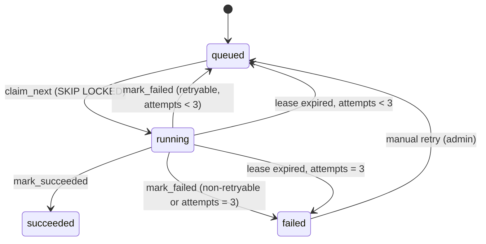
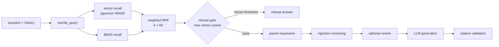

# Architecture

This document describes how the service is assembled and how a request moves through it. It reflects the current code, not a planned design. Design rationale for individual decisions is recorded in the ADRs under [`adr/`](adr/README.md).

## Layering

The codebase is split into four layers. Each layer only calls downward.

| Layer | Location | Responsibility |
|---|---|---|
| HTTP | `app/routers/` | Protocol handling: routing, request/response schemas, SSE framing, status codes. Tenant and user identity come from dependencies, never from the request body. |
| Assembly | `app/services.py` | Validates knowledge-base scope and constructs the components a request needs (retriever, pipeline, parent loader). This is the only place that decides which `src/*` pieces are wired together. |
| Domain | `src/*` | Ingestion, job state machine, chunking, embedding, brute-force and pgvector stores, BM25, RRF fusion, refusal, guard, citation validation, storage backends. |
| Storage | PostgreSQL 16 + pgvector, object store (local disk or S3/MinIO) | Durable state: documents, chunks and vectors, BM25 snapshots, job and event tables, traces, audit records; raw source files keyed by tenant and knowledge base. |

`app/main.py` is the application factory: it registers routers, mounts the static console at `/ui`, installs the HTTP metrics middleware, applies environment-driven CORS, and maps exceptions (`MissingTenantFilterError` → 500, `ScopeNotFoundError` → 404, anything unhandled → `500 Internal Server Error` with an `X-Trace-Id`).

## Ingestion

### Components

- `src/ingest.py` — `ingest_document()` performs: extract text → split into parent/child chunks → embed child chunks only → publish chunks, rebuild the BM25 snapshot and set the document to `ready` in one database transaction. Extractors cover `.pdf`, `.md`, `.txt`, `.docx`, `.pptx`, `.xlsx`.
- `src/ingest_jobs.py` — job lifecycle: `enqueue`, `claim_next`, `mark_progress`, `mark_succeeded`, `mark_failed`, `retry_job`, `reclaim_stale_running`.
- `src/worker.py` — `worker_once()` reclaims stale jobs, claims at most one job per loop, resolves the source object, runs the ingest executor and records stage events and heartbeats.
- `src/storage.py` — object storage abstraction with a local filesystem backend and an S3-compatible backend. Both use the same key layout, so switching backends requires no data migration.

### State machine



- `MAX_ATTEMPTS = 3` in `src/ingest_jobs.py`. Each claim increments `attempts`; `mark_failed` returns the job to `queued` while `attempts < MAX_ATTEMPTS`, otherwise it becomes terminal `failed`.
- `JOB_LEASE_SECONDS` defaults to `900`. `reclaim_stale_running()` runs at the start of every worker loop and requeues jobs whose `updated_at` is older than the lease, or marks them failed with `lease expired after 900 seconds` when attempts are exhausted. Invalid environment values fall back to the default.
- Manual retry is only allowed for `failed` jobs (`retry_job` resets `attempts`, `progress`, `error`, timestamps, and returns the document to `pending`). It is exposed at `POST /v1/ops/jobs/{job_id}/retry` and requires both `OPS_ENABLE_ACTIONS=1` and a user whose `users.role` is `admin`.
- Non-retryable conditions (missing source object, unreadable Office document, scanned PDF without OCR on the local path) go straight to terminal failure so the worker does not burn three attempts on an input that cannot recover.

### Upload ordering

`POST /v1/kbs/{kb_id}/documents` commits the `documents` row and the `ingest_jobs` row before writing the object. If the object write fails, the document is marked `failed`; a database failure leaves no orphaned object. Concurrent uploads of identical content converge on one `doc_id` through the `(tenant_id, kb_id, content_hash)` uniqueness constraint and content-hash deduplication.

### Object key layout

```text
{tenant_id}/{kb_id}/{doc_id}{suffix}
```

`documents.source_url` stores this key unchanged, which is why `local` and `s3` backends are interchangeable. The same relative path is used by `src/ingest_jobs.py` for connector-sourced documents and by the upload router.

## Query



1. **Rewrite** — `src/rewrite.py` folds conversation history into a standalone query. Rules decide whether rewriting is needed; the LLM is called only when it is.
2. **Recall** — `src/retrieve.py` runs vector recall (`PgVectorStore`, HNSW with cosine distance) and BM25 recall over the per-knowledge-base snapshot (`src/bm25_store.py`). Both fetch `recall_k` candidates (default 40). In `vector` or `bm25` mode only one path runs.
3. **Fusion** — weighted RRF: `score = Σ weight_i / (k + rank_i)` with `k = 60`. Route weights come from `src/route.py`; a router classifies model-number/error-code queries toward BM25. Ties break by `chunk_id`. Because this score is a function of rank only, the vector cosine of each hit is carried in `metadata["vector_score"]`.
4. **Refusal gate** — `src/pipeline.py` asks `src/refusal.py` for the maximum vector cosine in the candidate set and compares it to `REFUSAL_MIN_SIMILARITY` (default `0.56`). If it is below the threshold, the answer is a refusal and no generation call is made. Pure BM25 retrieval exposes no cosine and is allowed through to the model.
5. **Parent expansion** — child chunks provide the match; `fetch_parent_texts()` replaces their text with the full parent section while citations keep the child `chunk_id`.
6. **Injection screening** — `src/guard/injection.py` removes suspicious context chunks before prompting and checks the answer on the way out, including the canary string. Suspicious chunks are dropped from the prompt but remain stored for audit.
7. **Optional rerank** — `src/rerank.py` is invoked only when configured; failures degrade to the fused order (`rerank_degraded` is reported).
8. **Generation and citation validation** — the answer prompt carries one `[chunk_id]` header per context block. `src/citation.py` extracts bracketed identifiers, excludes Markdown links, and reports identifiers that were not in the context. The answer is returned unchanged with a validity report; the caller decides how to present it.

## Isolation

Three mechanisms compose:

1. **Explicit scope** — every query takes `tenant_id` and `kb_id`; `ensure_kb()` returns `404` when the knowledge base does not belong to the current tenant. `PgVectorStore` raises `MissingTenantFilterError` if a query is built without tenant scope.
2. **Row-level security** — `migrations/versions/0007_rls_chunks.py` creates the non-superuser role `kb_app` and enables plus forces RLS on `chunks` with policy `p_chunks_tenant`, evaluated against `current_setting('app.tenant_id', true)`. `src/db/session.py` sets this value transaction-locally. A missing scope yields zero rows (fail-closed), not another tenant's data.
3. **Document ACL** — `src/acl.py` treats chunks without `meta.acl_tags` as public; tagged chunks require an intersection with the user's tags. The condition is applied inside the SQL query for vector search, so restricted rows cannot consume `top_k`, and in memory for the BM25 path, whose inverted index has no SQL predicate.

## Processes and ports

| Component | Purpose | Port |
|---|---|---|
| api | FastAPI application, `/ui` console, OpenAPI at `/docs` | 8000 |
| db | PostgreSQL 16 with pgvector | container 5432, host-mapped 5433 |
| worker | Single-replica ingestion worker | none |
| parser | pdfplumber parser with OCR fallback | 8100 (host), 8000 (container) |
| minio | S3-compatible object storage, optional | 9000 API, 9001 console |
| gateway (demo) | nginx reverse proxy with Basic Auth and rate limiting | 18000 host → 80 container |

The demo overlay replaces the published API and database ports, so the only public entry point is the gateway on `18000`.

## Data model

Alembic revisions build the schema incrementally: `0001` base tables, `0002` HNSW index on `chunks.embedding`, `0003` BM25 support, `0004` parent chunk linkage, `0005` ACL tags, `0006` admin role, `0007` RLS and the application role, `0008` active knowledge-base version, `0009` ingest job fields, `0010` operations cockpit tables, `0011` observability tables. `migrations/versions/` is the authoritative list.
